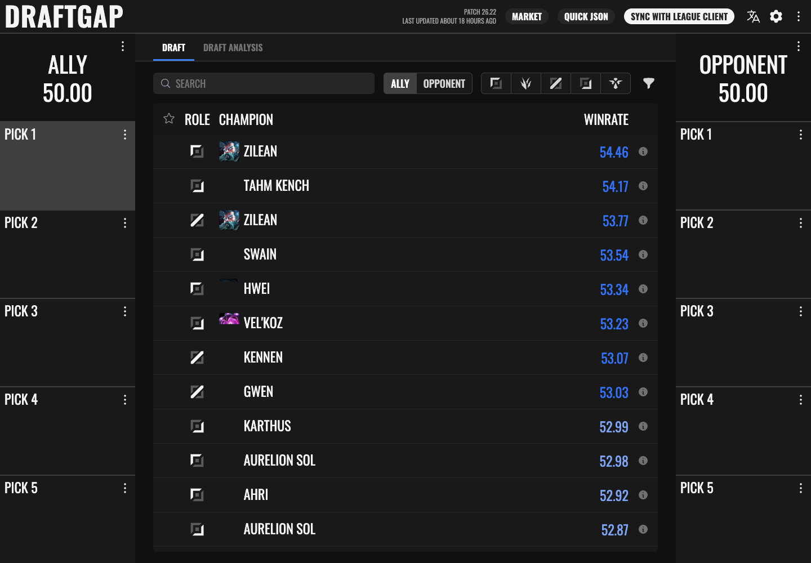
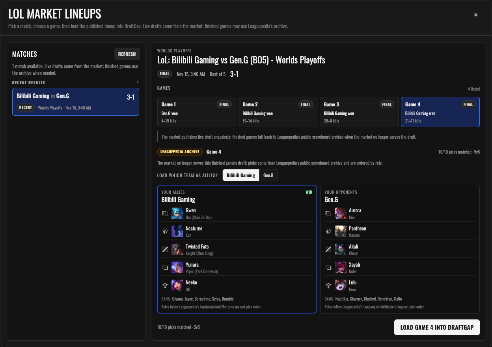
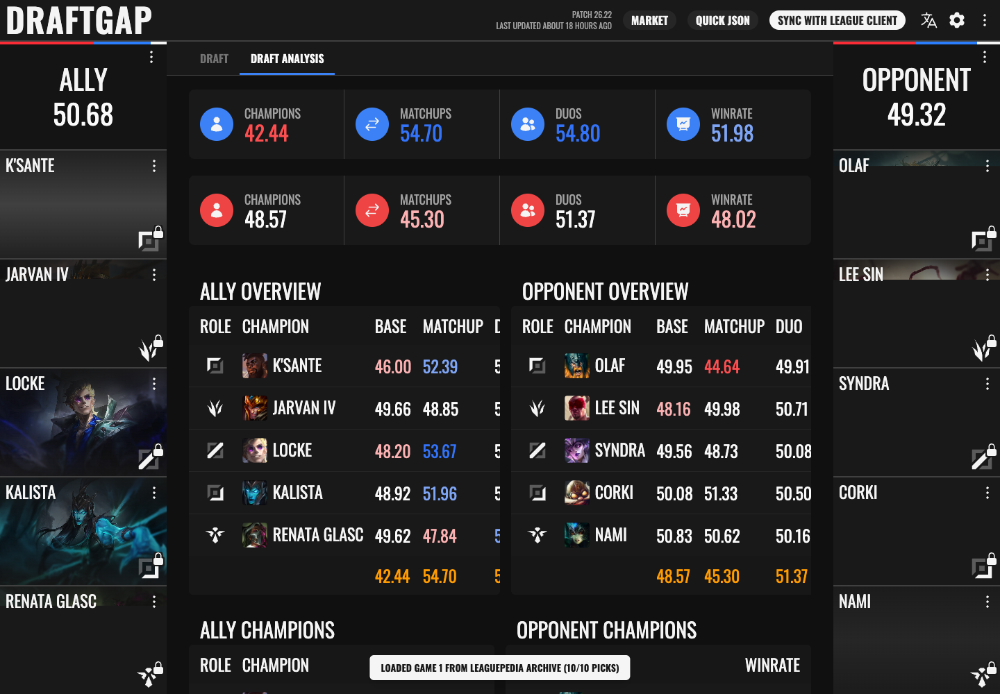

# DraftGap Draft Winrate Model (Reproducible Python Implementation)

**English** · [简体中文](README.zh-CN.md)

An independent, local-only reproduction of the draft winrate model behind [draftgap.com](https://draftgap.com/). It has no runtime third-party dependencies and provides:

- **Python library**: `model.analyze(payload)` returns structured results.
- **CLI**: read a draft from JSON and print JSON or a human-readable report.
- **Local HTTP service + 1:1 DraftGap page**: the original CSS, fonts, layout, and interactions (both sidebars, Draft / Draft Analysis tabs, champion table, matchup/synergy details, time scaling). The extra **Quick JSON** dialog predicts a pasted draft or loads it onto the board.
- **LoL market lineup import**: the **Market** button lists LoL matches, expands the played games (`Game 1/2/3…`), shows both lineups and bans, and loads a lineup into DraftGap with one click.
- **Live data**: the service checks the upstream dataset at startup and every five minutes using `ETag`/`Last-Modified`, then hot-swaps the model. The Sync button and `POST /api/refresh` trigger the same check manually.
- **Real-time integration**: an in-process 5v5 call takes about **2 ms** without suggestions and **27–40 ms** with complete suggestion tables.
- **Browser E2E**: [agent-browser](https://github.com/vercel-labs/agent-browser) verifies the market list → games → lineup → DraftGap flow.



The core model has been checked value-by-value against the page's built-in test draft: **all eight overview cards, ten per-champion rows, ten same-role matchups, and twenty synergy entries match the page to 0.01**.

---

## 1. Quick start

Python 3.10+ is required. Python 3.14 was used for the measurements below.

```bash
git clone https://github.com/HyiKi/draftgap-rea.git
cd draftgap-rea

# The first run downloads both v5 datasets into data/.
python3 draftgap_model.py --draft examples/draft.json --format pretty
```

Output:

```text
DraftGap draft model | current patch 16.22.1 @ 2026-11-15T18:27:27.113Z | 30-day @ 2026-11-15T18:27:41.409Z
risk medium (prior 1000 games) | 173 champions

ALLY     58.58%   (champions 49.29 | matchups 52.27 | duos 53.17)
OPPONENT 41.42%   (champions 45.28 | matchups 47.73 | duos 50.81)

ALLY OVERVIEW
ROLE       CHAMPION            BASE  MATCHUP     DUO   TOTAL
Top        Maokai             49.66    50.15   49.97   49.78
Jungle     Viego              50.05    48.42   50.34   48.81
Middle     Karthus            49.53    50.72   51.13   51.39
Bottom     Kalista            48.92    52.79   51.33   53.03
Support    Thresh             51.14    50.19   50.40   51.73
                              49.29    52.27   53.17   54.73
...
```

Start the 1:1 page:

```bash
python3 draftgap_model.py --serve
# Open http://127.0.0.1:8765/
```

The board starts empty, as on DraftGap. Click a champion in the table to add it to the active side. There are two extra entry points:

- **Quick JSON**: paste `examples/draft.json`, then predict, format, copy the result, or load it onto the board.
- **Market**: choose an LoL match and game, load a published lineup from the market feed or the Leaguepedia archive, and send it to DraftGap (see 7.4).

Dialogs use the native `<dialog>` element, support `Esc`/backdrop dismissal and screen-reader announcements, and Quick JSON accepts `⌘`/`Ctrl` + `Enter` to predict. The API can also be called directly:

```bash
curl -s -X POST http://127.0.0.1:8765/predict \
  -H 'Content-Type: application/json' \
  --data-binary @examples/draft.json
```

Other commands:

```bash
python3 draftgap_model.py --info                    # dataset versions, dates, risk priors
python3 draftgap_model.py --download                # download only missing datasets
python3 draftgap_model.py --refresh --draft examples/draft.json   # force a dataset refresh
python3 validate_fidelity.py                        # compare against captured page values
python3 -m unittest discover -s tests -v            # Python behavior tests
npm install && npx agent-browser install            # first time: E2E CLI + browser
npm run test:e2e                                    # browser end-to-end test
```

### 1.1 Illustrated web UI walkthrough

#### 1. Start the page

```bash
python3 draftgap_model.py --serve
```

Open <http://127.0.0.1:8765/>. The empty board matches DraftGap; click any champion in the suggestion table to begin.


#### 2. Open a market lineup

Click **Market** in the header:

1. **Matches** lists live, upcoming, and recently finished LoL matches.
2. Select a match to see the games that were actually played (`Game 1/2/3…`).
3. Select a game to see both lineups, players, roles, bans, source, and coverage.



#### 3. Load it into DraftGap

Choose the side to treat as allies under **Load which team as allies?**, then click **Load Game N into DraftGap**. The page:

- POSTs the draft to the local `/predict` endpoint;
- writes both lineups onto the board;
- switches to **Draft Analysis**, showing the winrate, matchups, and synergy details.



#### 4. Quick JSON prediction

**Quick JSON** accepts the same draft shape as `examples/draft.json`, then predicts, formats, copies, or loads it onto the board. Use `⌘`/`Ctrl` + `Enter` to predict and `Esc` to close.

> The market integration chooses a source by match state: live matches prefer the market live feed; finished matches whose draft is no longer served fall back to the public Leaguepedia scoreboard archive. The UI always labels the source and never presents an archive as live data.

---

## 2. Input format

The minimal form only needs champion names:

```json
{
  "allies": ["Maokai", "Viego", "Karthus", "Kalista", "Thresh"],
  "opponents": ["Camille", "Lee Sin", "Seraphine", "Kai'Sa", "Soraka"]
}
```

Roles are recommended:

```json
{
  "allies": [
    { "champion": "Maokai",  "role": "top" },
    { "champion": "Viego",   "role": "jungle" },
    { "champion": "Karthus", "role": "middle" },
    { "champion": "Kalista", "role": "bottom" },
    { "champion": "Thresh",  "role": "support" }
  ],
  "opponents": [
    { "champion": "Camille",   "role": "top" },
    { "champion": "Lee Sin",   "role": "jungle" },
    { "champion": "Seraphine", "role": "middle" },
    { "champion": "Kai'Sa",    "role": "bottom" },
    { "champion": "Soraka",    "role": "support" }
  ],
  "suggestions": 10
}
```

A role → champion object is also accepted:

```json
{
  "allies":    { "top": "Maokai", "jungle": "Viego", "middle": "Karthus", "bottom": "Kalista", "support": "Thresh" },
  "opponents": { "TOP": "Camille", "JUNGLE": "Lee Sin", "MIDDLE": "Seraphine", "BOTTOM": "Kai'Sa", "UTILITY": "Soraka" }
}
```

### 2.1 Champion identifiers

All of these forms are accepted case-insensitively:

- Riot numeric key: `57`, `"57"`
- DDragon id: `"Maokai"`, `"MonkeyKing"`, `"Kaisa"`
- English name: `"Maokai"`, `"Wukong"`, `"Kai'Sa"`, `"Lee Sin"`
- Chinese name from the dataset's `zh_CN` field: `"扭曲树精"`, `"齐天大圣"`, `"虚空之女"`
- Common aliases: `Wukong` → `MonkeyKing`, `KaiSa` → `Kai'Sa`

### 2.2 Roles

Accepted values are `0`–`4`, `top`, `jungle`, `middle` (`mid`), `bottom` (`bot` / `adc`), `support` (`sup` / `utility`), and the Chinese names `上单/打野/中单/下路/辅助`. Riot API `teamPosition` values (`TOP` / `JUNGLE` / `MIDDLE` / `BOTTOM` / `UTILITY`) work directly.

**When a role is omitted**, the model enumerates every feasible assignment using each champion's sample count in each role and picks the assignment with the largest total weight (the same logic as the page's `WS`/`Vp`). `roleInferred` marks a role that was inferred.

### 2.3 Configuration

Configuration may be top-level or inside a `config` object. Top-level values win.

| Key | Default | Description |
|---|---|---|
| `riskLevel` | `"medium"` | `very-low` / `low` / `medium` / `high` / `very-high`, mapping to 3000/2000/1000/500/250 prior games |
| `priorGames` | — | Extension: override the prior game count directly (>0) |
| `ignoreChampionWinrates` | `false` | Same switch as the page: zero the champion base winrate term on both sides |
| `suggestions` | `0` | Return the top N champions per side (0–1000); results exist only when a role is open |
| `minGames` | `1000` | Minimum **weekly** sample for suggestions (30-day games ÷ 30 × 7) |
| `scaling` | `true` | Compute the time-scaling curve |
| `includeTables` | `true` | Return all 25 matchups and synergy details; `false` omits the `matchups` / `duos` keys |

`bans` is optional and annotation-only:

```json
{ "bans": ["Yuumi", "Smolder"] }
```

---

## 3. Output

The default output is JSON. Core fields:

```json
{
  "model": {
    "currentPatch": { "version": "16.22.1", "date": "...", "champions": 173 },
    "thirtyDay": { "version": "30", "date": "..." },
    "config": { "riskLevel": "medium", "priorGames": 1000, "minGames": 1000 }
  },
  "draft": {
    "allies": [
      {
        "championKey": "57", "championId": "Maokai", "name": "Maokai", "nameZh": "扭曲树精",
        "role": 0, "roleName": "Top", "roleNameZh": "上单", "roleInferred": false,
        "roleProbabilities": [{"role": 0, "roleName": "Top", "probability": 1.0}],
        "totalRating": -1.52, "totalWinrate": 0.4978, "totalText": "49.78"
      }
    ],
    "opponents": [],
    "roleAssignmentsEvaluated": { "allies": 1, "opponents": 1 },
    "bans": []
  },
  "prediction": {
    "allyWinrate": 0.5858,
    "allyWinrateText": "58.58",
    "opponentWinrate": 0.4142,
    "opponentWinrateText": "41.42",
    "ally": {
      "championRating": -4.95,
      "championWinrate": 0.4929,
      "championWinrateText": "49.29",
      "matchupRating": 15.82,
      "matchupWinrate": 0.5227,
      "matchupWinrateText": "52.27",
      "duoRating": 22.08,
      "duoWinrate": 0.5317,
      "duoWinrateText": "53.17",
      "totalRating": 60.21,
      "winrate": 0.5858,
      "winrateText": "58.58"
    },
    "opponent": { "...": "same shape" }
  },
  "breakdown": {
    "allies": {
      "rows": [
        {
          "role": 0, "roleName": "Top", "championKey": "57", "name": "Maokai",
          "baseRating": -2.39, "baseWinrate": 0.4966, "baseText": "49.66",
          "matchupRating": 1.06, "matchupWinrate": 0.5015, "matchupText": "50.15",
          "duoRating": -0.19, "duoWinrate": 0.4997, "duoText": "49.97",
          "totalRating": -1.52, "totalWinrate": 0.4978, "totalText": "49.78"
        }
      ],
      "totals": {
        "baseRating": -4.95, "baseText": "49.29",
        "matchupRating": 15.82, "matchupText": "52.27",
        "duoRating": 22.08, "duoText": "53.17",
        "totalRating": 32.94, "totalText": "54.73"
      }
    },
    "opponents": { "...": "same shape" }
  },
  "matchups": {
    "results": [ "... 25 entries with allyText / opponentText ..." ],
    "sameRoleResults": [ "... 5 same-role entries ..." ],
    "totals": {
      "all":     { "allyText": "52.27", "opponentText": "47.73" },
      "sameRole":{ "allyText": "49.12", "opponentText": "50.88" }
    }
  },
  "duos": {
    "allies":    { "results": [ "... 10 entries ..." ], "totals": { "winrateText": "53.17" } },
    "opponents": { "results": [ "... 10 entries ..." ], "totals": { "winrateText": "50.81" } }
  },
  "scaling": {
    "allies": [
      { "label": "0-20", "totalRating": -10.09, "winrate": 0.4855, "winrateText": "48.55" }
    ],
    "opponents": [ "... 5 time buckets ..." ]
  },
  "suggestions": {
    "allies": [
      { "name": "Zilean", "role": 0, "roleName": "Top", "winrateText": "54.46" }
    ],
    "opponents": []
  },
  "warnings": []
}
```

Conventions:

- Every `*Text` field is the two-decimal string shown by the page (aligned with `toFixed(2)`).
- Raw `winrate` values are floats in 0–1; `rating` values are in logit space.
- The card values `championWinrate` / `matchupWinrate` / `duoWinrate` are **not** complementary; each is `W()` of its own total. Only the final `allyWinrate` and `opponentWinrate` are complementary.
- The page's "team total" row is `W(sum of per-champion totalRating)` and differs from the team's final winrate (for example, 54.73 versus 58.58 for allies).
- The matchup table has two totals: `all` (all 25 matchups; the MATCHUPS card, 52.27) and `sameRole` (five same-role matchups; the HEAD 2 HEAD footer, 49.12).
- `roleProbabilities` are normalized assignment probabilities. An explicit role is always `1.0`; an omitted role can spread across multiple roles (the page's `Td` semantics).
- `roleAssignmentsEvaluated` is the number of feasible assignments per side. It is `1` when every role is explicit (or every champion has one feasible role), and can be used to detect ties in role inference.
- With `scaling: false`, `scaling` is `null`. With `includeTables: false`, the `matchups` and `duos` keys are omitted.
- `games` inside matchup/synergy entries is aggregated sample size, not a raw match count; dataset `wins` values can be fractional.
- `warnings` reports role-inference ties, empty sample pairs, champions that are both banned and picked, and similar conditions.

---

## 4. Model

### 4.1 Core functions

```text
W(x) = 1 / (1 + 10^(-x/400))          # logit -> winrate
L(p) = -400 * log10(1/p - 1)          # winrate -> logit
```

Let `C` be the current-patch data, `D` the 30-day data, and `n` the prior pseudo-game count selected by risk level.

### 4.2 Champion base rating (`HS`/`xd`)

For each champion-role pair:

```text
c = D.wins / D.games                   # c = 0.5 when D.games = 0
r = L( (C.wins + n*c) / (C.games + n) )
```

This shrinks the current-patch sample toward the 30-day same-role winrate. Sum each side:

```text
A_base = Σ r(allied champions)
B_base = Σ r(enemy champions)
```

### 4.3 In-team synergy (`_d`)

For every allied pair, enumerated in ascending role order:

```text
g   = L(wrA) + L(wrB)                  # 30-day base winrate
p   = W(g)                             # expectation without synergy data
m   = the two champions' mutual synergy samples
b   = (m.games_A + m.games_B) / 2
v   = (m.wins_A  + m.wins_B)  / 2
obs = (v + n*p) / (b + n)
C   = L(obs) - g                       # synergy correction
```

The allied synergy total is `A_duo = Σ C`; the enemy total is `B_duo`.

### 4.4 Cross-team matchups (`_KS`)

For every allied champion × enemy champion (25 pairs):

```text
f   = L(wrA) - L(wrB)
h   = W(f)
ga  = matchup(A vs B) from A's perspective
gb  = matchup(B vs A) from B's perspective
v   = (ga.wins + (gb.games - gb.wins)) / 2
b   = (ga.games + gb.games) / 2
obs = (v + n*h) / (b + n)
C   = L(obs) - f                       # matchup correction
```

`A_matchup = Σ C` over all 25 pairs.

### 4.5 Total and winrate

```text
total      = A_base + A_duo + A_matchup - B_base - B_duo
allyWinrate = W(total)
```

The enemy analysis swaps the sides and calls the same function again instead of negating the allied result. The overview cards therefore stay independent while the final winrates are exactly complementary.

### 4.6 Page cards and per-champion breakdown

- `CHAMPIONS` = `W(A_base)`
- `MATCHUPS` = `W(A_matchup)`
- `DUOS` = `W(A_duo)`
- `WINRATE` = `W(total)`
- Per-champion `BASE` = that champion's `HS`
- Per-champion `MATCHUP` = sum of all matchup corrections where `championKeyA` is that champion
- Per-champion `DUO` = sum of all synergies involving that champion ÷ 2
- Per-champion `TOTAL` = `BASE + MATCHUP + DUO`
- The table's team-total row applies `W()` after summing each column

### 4.7 Role inference

For champions without a role, enumerate every assignment to open roles:

```text
weight(assignment) = Π (30-day games at that role / all-role games for that champion)
```

Use the highest-weight assignment for the main analysis. Normalized weights for all assignments are returned in each champion's `roleProbabilities`. On a tie, take the first assignment in page order and emit a warning.

### 4.8 Time scaling (`wf`)

For five duration buckets (`0-20` / `20-25` / `25-30` / `30-35` / `35+`):

```text
base = (champ.wins + n*0.5) / (champ.games + n)
r_t  = L( (bucket.wins + n*base) / (bucket.games + n) ) - L(base)
```

Sum over the team and apply `W()`. The shrinkage center here is **50%**, unlike champion base rating (which shrinks toward the 30-day winrate).

### 4.9 Champion suggestions

For each open role and each champion that is not already picked or banned:

```text
30-day games at that role / 30 * 7 >= minGames
```

Place the champion temporarily in the open role, rerun the full model, and sort by final winrate descending. With both sides at five champions there are no suggestions.

### 4.10 Prior table

| Risk level | Prior pseudo-games |
|---|---:|
| very-low | 3000 |
| low | 2000 |
| medium (default) | 1000 |
| high | 500 |
| very-high | 250 |

The Builds (beta) model uses a different table (3000/2000/1000/750/500), but that is the Lolalytics item model and does not participate in draft winrate.

---

## 5. Data

DraftGap v5:

- `https://bucket.draftgap.com/datasets/v5/current-patch.json`
  - Observed version `16.22.1`, date `2026-11-15T18:27:27.113Z`
  - 173 champions; base `statsByRole` only (no `matchup`/`synergy`)
- `https://bucket.draftgap.com/datasets/v5/30-days.json`
  - Version `"30"`, date `2026-11-15T18:27:41.409Z`
  - 173 champions; complete `matchup` (5 enemy roles × ~172 champions) and `synergy` (4 allied roles × ~172 champions)

The upstream normally updates once a day; even when `version` stays `16.22.1`, the JSON `date` changes. At startup the service compares `ETag`/`Last-Modified` via `HEAD`; by default it checks every 300 seconds, downloads, validates, reloads, and hot-swaps the model without interrupting requests. `data/remote-meta.json` stores the most recent validation metadata.

Structure:

```json
{
  "version": "16.22.1",
  "date": "...",
  "championData": {
    "57": {
      "id": "Maokai",
      "key": "57",
      "name": "Maokai",
      "i18n": { "zh_CN": { "name": "扭曲树精" } },
      "statsByRole": {
        "0": {
          "games": 14838,
          "wins": 7369.649215587668,
          "matchup": {
            "3": {
              "145": { "championKey": "145", "games": 123, "wins": 66.5 }
            }
          },
          "synergy": {
            "1": {
              "234": { "championKey": "234", "games": 456, "wins": 230.2 }
            }
          },
          "damageProfile": { "physical": 1, "magic": 2, "true": 0 },
          "statsByTime": [ { "games": 1, "wins": 0.5 } ]
        }
      }
    }
  }
}
```

`wins` may be fractional because the dataset is aggregate statistics. During loading each matchup/synergy entry is compressed in place to a `(games, wins)` tuple to reduce memory.

---

## 6. Fidelity validation

The page's built-in test draft (`window.DRAFTGAP_DEBUG.test()`):

- Allies: Maokai top, Viego jungle, Karthus middle, Kalista bottom, Thresh support
- Opponents: Camille top, Lee Sin jungle, Seraphine middle, Kai'Sa bottom, Soraka support

Page values captured on 2026-11-15 (the animated header numbers are not used as a baseline; the `DRAFT ANALYSIS` cards are):

| Item | Page | This implementation |
|---|---|---|
| Ally base / matchup / synergy / winrate | `49.29 / 52.27 / 53.17 / 58.58` | match |
| Opponent base / matchup / synergy / winrate | `45.28 / 47.73 / 50.81 / 41.42` | match |
| Ally per-champion TOTAL | `49.78 / 48.81 / 51.39 / 53.03 / 51.73` | match |
| Opponent per-champion TOTAL | `51.57 / 47.34 / 48.37 / 48.19 / 48.34` | match |
| Ally table totals | `49.29 / 52.27 / 53.17 / 54.73` | match |
| Opponent table totals | `45.28 / 47.73 / 50.81 / 43.83` | match |
| HEAD 2 HEAD same role | `49.42/50.58`, `48.94/51.06`, `49.96/50.04`, `51.04/48.96`, `49.76/50.24` | match |
| Same-role matchup totals | `49.12 / 50.88` | match |
| Ally 10 synergy rows | `50.06 … 50.88` | all match |
| Opponent 10 synergy rows | `50.25 … 49.93` | all match |

Run:

```bash
python3 validate_fidelity.py
# PASS: all 19 captured page checks match
#   ally winrate 58.58 / opponent 41.42
#   dataset 16.22.1 (2026-11-15T18:27:27.113Z)
```

The comparison covers all four per-champion columns across ten rows, the matchup table, and the synergy table. Upstream data changes daily; when the dataset date differs from the captured snapshot, `validate_fidelity.py` prints `SKIP` and exits with status 2 so new data is not mistaken for a model regression.

**Why do the big header numbers animate from 50?** The original page tweens the `Sy` number. `validate_fidelity.py` and the tests use the static `DRAFT ANALYSIS` cards.

**Why does the page show PATCH 26.22 while the data says 16.22.1?** The display function is `parseInt(major) + 10`, which turns DDragon `16.22.1` into Riot season patch `26.22`. It is not the dataset version. The 1:1 page reproduces that display; the CLI and API use the real dataset version `16.22.1`.

---

## 7. Integrating an external match API

### 7.1 In-process calls (lowest latency)

Load the model once at process startup; each draft then takes about 2 ms:

```python
import json
from draftgap_model import load_model

model = load_model("./data")  # once at startup, ~3.4 s / 521 MB peak

def predict(blue_participants, red_participants):
    payload = {
        "allies": [
            {"champion": p["championId"], "role": p["teamPosition"]}
            for p in blue_participants
        ],
        "opponents": [
            {"champion": p["championId"], "role": p["teamPosition"]}
            for p in red_participants
        ],
        "suggestions": 0,       # disable for live predictions; enable when needed
    }
    result = model.analyze(payload)
    return result["prediction"]["allyWinrateText"]  # "58.58"

# Example: Riot Match-V5 participants, where teamPosition is TOP/JUNGLE/MIDDLE/BOTTOM/UTILITY
# print(predict(blue, red))
```

`championId`, `championKey`, DDragon id, English name, and Chinese name can be mixed. Roles accept Riot `teamPosition` values or `top/jungle/mid/bottom/support`. If an external API only provides champion names, pass the names directly.

### 7.2 HTTP service and responses

Start:

```bash
python3 draftgap_model.py --serve
# default: http://127.0.0.1:8765/

# allow one frontend dev server (prefer an exact origin)
python3 draftgap_model.py --serve --cors http://localhost:5173

# any origin (local debugging only; any web page can call the service)
python3 draftgap_model.py --serve --cors '*'
```

`--cors` is repeatable. By default no CORS header is sent and only same-origin pages can call the service. Cross-origin browsers send `OPTIONS /predict` first; the service returns `204` with the allowed methods/headers.

Request:

```bash
curl -s -X POST http://127.0.0.1:8765/predict \
  -H 'Content-Type: application/json' \
  --data-binary @examples/draft.json
```

A successful response is `200` with the model result object from section 3 (no extra `ok`/`data` wrapper). To return only the winrate and components:

```json
{
  "includeTables": false,
  "scaling": false
}
```

The response is about 10 KB; `matchups` / `duos` are omitted and `scaling` is `null`. A complete 5v5 response is about 34 KB. Core fields:

```json
{
  "model": {
    "currentPatch": { "version": "16.22.1" },
    "config": { "riskLevel": "medium", "priorGames": 1000 }
  },
  "draft": {
    "allies": [ "..." ],
    "opponents": [ "..." ],
    "roleAssignmentsEvaluated": { "allies": 1, "opponents": 1 }
  },
  "prediction": {
    "allyWinrate": 0.5858,
    "allyWinrateText": "58.58",
    "opponentWinrate": 0.4142,
    "opponentWinrateText": "41.42",
    "ally": {
      "championWinrateText": "49.29",
      "matchupWinrateText": "52.27",
      "duoWinrateText": "53.17",
      "winrateText": "58.58"
    },
    "opponent": { "...": "same shape" }
  },
  "breakdown": {
    "allies": { "rows": [ "..." ], "totals": { "totalText": "54.73" } }
  },
  "suggestions": {
    "allies": [ { "championKey": "26", "name": "Zilean", "role": 0, "winrateText": "54.46" } ],
    "opponents": [ "..." ]
  },
  "warnings": []
}
```

Typical frontend usage:

```js
const response = await fetch('http://127.0.0.1:8765/predict', {
  method: 'POST',
  headers: { 'Content-Type': 'application/json' },
  body: JSON.stringify({
    allies,
    opponents,
    includeTables: false,
    scaling: false,
  }),
});
const data = await response.json();
if (!response.ok) throw new Error(`${data.code}: ${data.error}`);
console.log(data.prediction.allyWinrateText); // "58.58"
```

Errors are consistent:

```json
{ "error": "unknown champion 'Nobody'", "code": "invalid_input" }
```

| HTTP | code | Scenario |
|---|---|---|
| 400 | `empty_body` | `Content-Length` is 0 |
| 400 | `invalid_json` | body is not valid JSON |
| 400 | `invalid_input` | bad champion/role/config, duplicate champions, etc. |
| 404 | `not_found` | path does not exist |
| 405 | `method_not_allowed` | non-POST request to `/predict` |
| 413 | `payload_too_large` | body exceeds 2 MB |
| 500 | `internal_error` / `serialization_error` | server failure (internal details are not exposed) |

`GET /health` returns:

```json
{
  "ok": true,
  "currentPatch": "16.22.1",
  "currentPatchDate": "2026-11-15T18:27:27.113Z",
  "thirtyDayDate": "2026-11-15T18:27:41.409Z",
  "champions": 173,
  "lastChecked": "2026-11-16T04:25:55.509934+00:00",
  "refreshError": null,
  "refreshing": false,
  "refreshIntervalSeconds": 300.0
}
```

Routes:

| Route | Purpose |
|---|---|
| `GET /` | 1:1 DraftGap page |
| `GET /assets/*`, `/fonts/*` | CSS/JS/fonts/icons loaded into memory at startup |
| `GET /health` | dataset versions, last refresh time, refresh errors |
| `GET /api/bootstrap` | champions, roles, current-patch base winrates, damage profiles |
| `POST /api/refresh` | trigger an immediate upstream check; returns `{"ok": true, "refreshing": true}` |
| `POST /predict` | model prediction (optionally with `suggestions`) |

Refresh options:

```bash
python3 draftgap_model.py --serve --refresh-interval 60      # check every 60 seconds
python3 draftgap_model.py --serve --no-auto-refresh          # disable background refresh
python3 draftgap_model.py --serve --refresh-interval 0       # same as disabling it
```

The service listens on `127.0.0.1:8765` by default and has no authentication. **Do not expose it directly to the public internet**; if cross-host access is required, add a reverse proxy and authentication. `--cors` only relaxes the browser same-origin policy, not access control.

### 7.3 Real-time guidance

- Load the model once and keep it in memory; do not call `load_model` per request.
- A 5v5 prediction without suggestions takes about **2.2 ms** on this machine (Python 3.14).
- The 1:1 page requests complete suggestion tables (`suggestions: 1000`): about **27 ms** on an empty board and **40 ms** for a 2v2 partial draft (roughly 250–459 candidates per side). With both sides full, no roles are open and suggestions return immediately.
- If only the winrate is needed, disable `includeTables`, `scaling`, and `suggestions` to keep the response small.
- The dataset updates daily; the service checks every 300 seconds and hot-swaps the model. Long-running in-process callers should also refresh or reload periodically.
- `GET /api/bootstrap` already contains the champion base data the page needs; `POST /predict` suggestions are the dynamic candidate table and do not re-parse the raw dataset.

### 7.4 LoL market lineup import

The **Market** button in the header opens a native dialog:

1. **Matches** lists live, upcoming, and recently finished matches in the LoL market series, with competition, score, and start time.
2. **Games** lists the games that were actually played (`Game 1/2/3…`), with winner and kills. Prop markets such as "Game 5 duration" are not mistaken for games.
3. **Lineup** shows both champion picks (by role), bans, players, source, and coverage for the selected game.
4. **Load into DraftGap** chooses which side is allied, writes both lineups to the board, POSTs `/predict`, and switches to Draft Analysis.

Read-only endpoints (no authentication):

| Route | Purpose |
|---|---|
| `GET /api/market/matches?limit=24&refresh=0` | LoL match list; `limit` 1–40, `refresh=1` clears the cache |
| `GET /api/market/match?slug=lol-blg-gen-2026-11-14` | match detail, teams, and played games |
| `GET /api/market/lineup?slug=…&game=4` | picks, bans, source, and coverage for one game |

Example (BLG vs Gen.G final, Game 4):

```bash
curl -s 'http://127.0.0.1:8765/api/market/lineup?slug=lol-blg-gen-2026-11-14&game=4'
```

Key fields:

```json
{
  "game": 4,
  "home": {
    "name": "Bilibili Gaming",
    "picks": [
      {
        "champion": "Gwen",
        "championKey": "887",
        "championId": "Gwen",
        "role": 0,
        "player": "Bin (Chen Ze-Bin)",
        "resolved": true
      }
    ],
    "bans": [ "..." ],
    "roleSource": "leaguepedia-pick-order"
  },
  "away": { "name": "Gen.G", "picks": [ "..." ], "bans": [ "..." ] },
  "source": {
    "kind": "leaguepedia",
    "label": "Leaguepedia archive",
    "note": "The market no longer serves this finished game's draft; picks come from Leaguepedia's public scoreboard archive and are ordered by role."
  },
  "coverage": {
    "picks": 10,
    "resolved": 10,
    "unresolved": 0,
    "homePicks": 5,
    "awayPicks": 5,
    "complete": true
  },
  "winnerSide": "home",
  "warnings": []
}
```

The source is chosen by match state and always labeled in the UI:

- **Live matches**: subscribe to the public market WebSocket channel `esports.series` and read `players[].character` and `draft[]` from the live snapshot. Player order supplies Top/Jungle/Middle/Bottom/Support. If only a ban/pick stream exists, picks are retained with `roleSource: "unavailable"`; roles are not guessed.
- **Public HTTP series state**: provides score summaries only. It fills in scores and kills when no live snapshot is available; it never invents a lineup.
- **Finished matches**: when the market no longer serves the draft, fall back to the public Leaguepedia Cargo scoreboard archive (`lol.fandom.com`), matched by date and team names. Picks are ordered top/jungle/mid/bottom/support and marked `source.kind: "leaguepedia"`.
- **No lineup**: returns `coverage.picks: 0` and a warning explaining why; an empty array is never presented as a published lineup.

If the machine needs a proxy to reach the market (for example `http://127.0.0.1:7891`):

```bash
python3 draftgap_model.py --serve --proxy=http://127.0.0.1:7891
```

Without an explicit flag, the service reads `HTTPS_PROXY` and then `HTTP_PROXY`; it does not use system proxy auto-discovery. The proxy is used only for market and Leaguepedia requests and does not rewrite or persist other environment variables.

Market endpoint errors:

| HTTP | code | Scenario |
|---|---|---|
| 400 | `invalid_limit` / `missing_slug` / `invalid_slug` | invalid parameters |
| 400 | `missing_game` / `invalid_game` | game parameter missing or not an integer from 1–9 |
| 404 | `game_not_found` / `upstream_not_found` | the match has no such game, or upstream has no data |
| 502 | `upstream_http_error` / `upstream_unreachable` | market/Leaguepedia error or unreachable; `upstream_unreachable` includes a proxy hint |
| 502 | `invalid_upstream_response` / `upstream_too_large` | malformed upstream response or size limit exceeded |

**Verification scope**: the four archived games of the BLG vs Gen.G final (`lol-blg-gen-2026-11-14`) passed browser end-to-end verification, and all 10 champions resolve and load into a prediction. The live WebSocket path has been verified for transport, subscription, and snapshot parsing against a CS2 series that was live at the time. As of 2026-11-16 there were no live matches in the LoL market category, so **the real-data LoL live draft path remains unverified**. The public HTTP series-state endpoint returned only summaries for the finished series tested; the login-gated seed endpoint was not used.

### 7.5 Browser E2E with agent-browser

The repository uses [agent-browser](https://github.com/vercel-labs/agent-browser) for end-to-end testing. The test starts a real local service (including `POST /predict`) and mocks only the three market endpoints, so it is independent of upstream availability and of whether a particular match is still listed.

```bash
npm install
npx agent-browser install   # first run only; downloads Chrome for Testing
python3 draftgap_model.py --download   # if data/ is empty
npm run test:e2e
```

Node.js 22+ is required by this harness. agent-browser currently declares Node.js 24+; version 0.41.2 with Node.js 22.18 completed the suite successfully here.

Files:

- `tests/e2e/run.sh` starts the server, registers mocks, drives the browser, and asserts the result.
- `tests/e2e/fixtures/` contains stable fixtures captured from real BLG vs Gen.G responses.
- `tests/e2e/artifacts/` holds server logs for debugging and is gitignored.

Coverage:

1. open the **Market** dialog;
2. assert the match list;
3. assert all four played games;
4. assert the Game 4 lineup and Leaguepedia source;
5. switch to Game 1 and assert the lineup changes;
6. choose allies, load the game, and assert Draft Analysis shows both teams and a winrate;
7. assert there are no JavaScript page errors.

Screenshots (generated from the same E2E fixtures):

```bash
npm run screenshots
# docs/images/01-draft-board.png
# docs/images/02-market-lineup.png
# docs/images/03-analysis.png
```

---

## 8. Performance and resources

Measured on this machine (Python 3.14, macOS):

| Item | Value |
|---|---:|
| Initial load (parse/compress 51 MB + 372 KB JSON) | ~3.4 s |
| Peak RSS after loading | ~521 MB |
| Full 5v5 prediction (no suggestions) | ~2.2 ms |
| Empty board + full suggestion table per side (459/side) | ~27 ms |
| 2v2 partial draft + full suggestion table per side (250/side) | ~40 ms |

Peak memory is dominated by the roughly 1.35 million matchup/synergy entries in the 30-day dataset. If memory is tight, retain only the champion subset you need; the current implementation keeps all data for simplicity and reproducibility.

---

## 9. Limitations and unverified items

- **Verified**: the final winrate from `Il`/`HS`/`_d`/`KS`, the four component cards, all four per-champion columns, team totals, all 25 matchups, all 10 synergies, and the same-role footnote exactly match the static page values captured on 2026-11-15. The Draft suggestion table also matches the page row-by-row for an empty board (459 rows) and after selecting Maokai, including dynamic winrates and `minGames` filtering.
- **Source-derived only, not point-by-point UI captures**: time scaling (the page draws it with Chart.js canvas and was not captured point-by-point) and role inference (the page test entry uses explicit roles; no no-role scenario was constructed). Both reuse verified core functions, and their formulas were transcribed line-by-line from the bundle.
- **Not included**: Builds (beta) items/runes (Lolalytics API, independent of draft winrate), real League Client sync (the page's Sync button triggers a local dataset refresh instead), and account/LCU ownership state. Favorites, language, and role filters are implemented locally.
- **Market LoL live is not verified against a real LoL match**: live WebSocket transport and snapshot parsing were verified with a live CS2 series; during testing there were no live matches in the LoL market category. The finished-match archive path (Leaguepedia) was fully verified with the BLG vs Gen.G final.
- **Unknown data generator**: how the DraftGap backend produces the aggregated v5 data from raw matches is not in the frontend bundle; this project only consumes the public v5 data.
- **Version drift**: the model and data structures may change with DraftGap. If bundle names/hashes change, the formulas may need rechecking. The analyzed bundle is `index-DS2QEuLT.js`, SHA-256 `1ef2909b…9ca3a1`.
- **Empty sample pairs**: the page JS produces `NaN` when both synergy/matchup samples are empty. This implementation treats that degenerate case as neutral (rating 0) and emits a warning. Every pair has samples in normal v5 data, so this does not affect the validation above.
- **`priorGames` is an extension**: the page exposes only risk levels; overriding the prior game count directly is useful for experiments.
- **Display rounding**: `Decimal(float).quantize(ROUND_HALF_UP)` matches positive `toFixed(2)`; this was checked against captured page values and boundary cases.

---

## 10. Evidence and sources

- Page: <https://draftgap.com/>
- Main bundle: <https://draftgap.com/assets/index-DS2QEuLT.js>
  - SHA-256: `1ef2909b7cb59a7b2e1c9398b62902a31bc74b2a296686f92ff1a9a2679ca3a1`
  - 765,448 bytes
- Datasets:
  - <https://bucket.draftgap.com/datasets/v5/current-patch.json>
  - <https://bucket.draftgap.com/datasets/v5/30-days.json>
- Capture date: 2026-11-16 (local timezone UTC+8; dataset date 2026-11-15T18:27Z)
- Page test entry: `window.DRAFTGAP_DEBUG.test()` (the page's built-in debug draft); Playwright read the rendered `document.body.innerText` as the baseline.
- `ax.lolalytics.com` was not called, and no DraftGap account or private endpoint was used.

This project is not affiliated with DraftGap. It is for local learning, research, and personal data analysis. Respect DraftGap's terms of service, dataset usage boundaries, and Riot's developer policies; do not commercially redistribute the datasets or this service.

---

## 11. File structure

```text
draftgap-rea/
├── draftgap_model.py        # model, CLI, HTTP service, dataset refresh, market integration
├── validate_fidelity.py     # compare against captured page values
├── README.md                # English README
├── README.zh-CN.md          # Simplified Chinese README
├── package.json             # agent-browser E2E dev dependency and scripts
├── package-lock.json
├── .gitignore
├── data/
│   ├── README.md
│   ├── current-patch.json   # auto-downloaded; gitignored
│   ├── 30-days.json         # auto-downloaded; gitignored
│   └── remote-meta.json     # ETag/Last-Modified validation metadata; gitignored
├── docs/
│   └── images/              # README screenshots; generated by npm run screenshots
├── web/
│   ├── index.html           # 1:1 DraftGap page shell
│   ├── assets/
│   │   ├── app.css          # original compiled CSS
│   │   ├── ui.css           # native dialogs, focus, Quick JSON, market styles
│   │   ├── app.js           # page state, prediction, Quick JSON, market import
│   │   └── favicon.ico
│   └── fonts/               # Oswald / OpenSans variable fonts
├── examples/
│   ├── draft.json           # full 5v5 page test draft
│   └── draft-partial.json   # 3+2 champions for suggestion demos
└── tests/
    ├── test_model.py        # 12 model behavior tests
    ├── test_market.py       # 5 market/Leaguepedia parsing and provenance tests
    ├── test_server.py       # 10 HTTP contract tests (page/assets/bootstrap/CORS/market params)
    └── e2e/
        ├── run.sh           # agent-browser end-to-end test
        ├── fixtures/        # stable market API fixtures
        └── artifacts/       # run logs; gitignored
```
