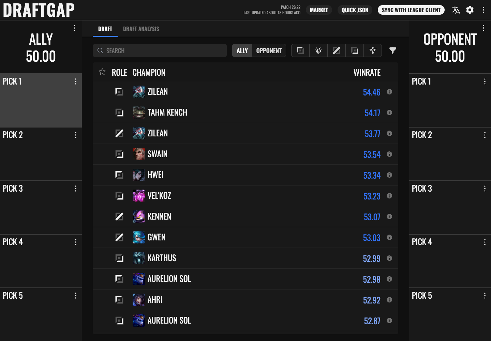
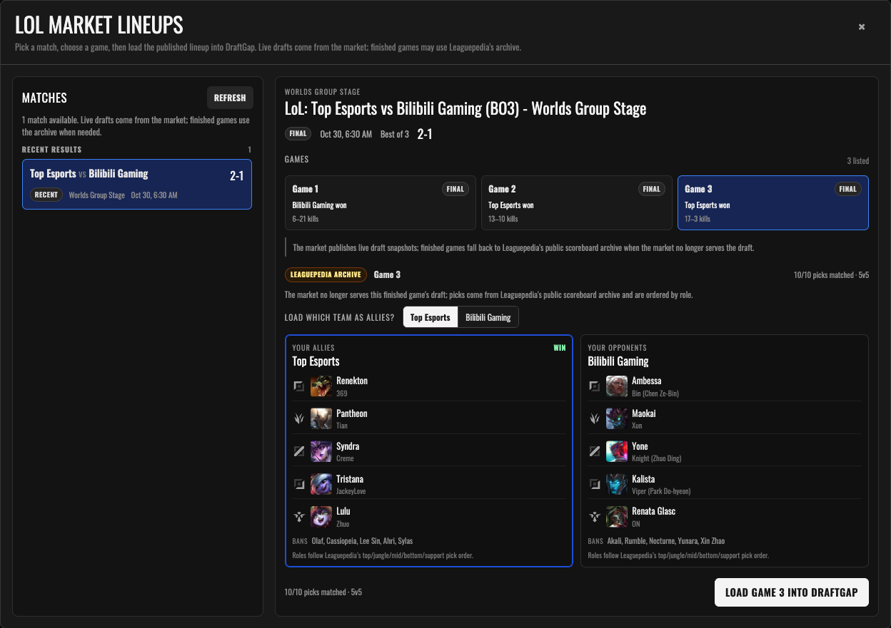
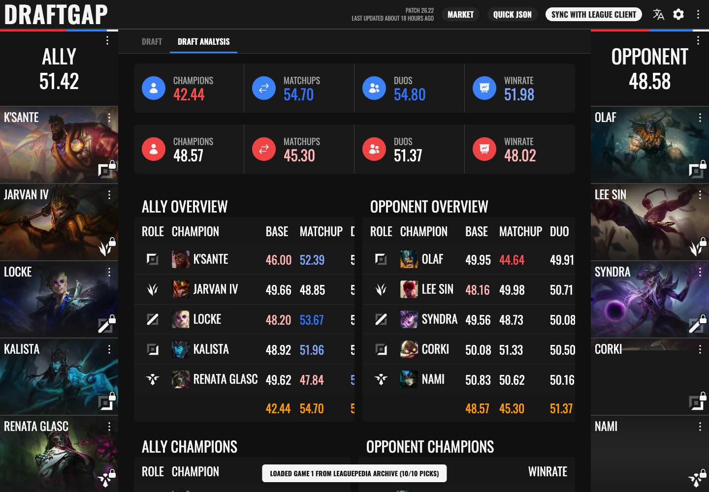

# DraftGap 阵容胜率模型

[English](README.md) · **简体中文**

这是对 [draftgap.com](https://draftgap.com/) 前端阵容胜率模型的独立复现。零运行时第三方依赖，支持：

- **Python 库**：`model.analyze(payload)` 直接返回结构化结果。
- **命令行**：读取 JSON 阵容，输出 JSON 或人类可读报告。
- **本地 HTTP 服务 + 1:1 DraftGap 页面**：使用原站 CSS、字体、布局和交互（双方侧栏、Draft / Draft Analysis、候选表、对位/协同明细、时间曲线）；顶部 **Quick JSON** 按钮是额外扩展，可直接粘贴阵容 JSON 预测或载入棋盘。
- **LoL market 阵容导入**：顶部 **Market** 按钮列出 LoL 比赛，展开 Game 1/2/3…，选中后展示双方英雄与禁用，并可一键载入棋盘预测。
- **实时数据**：启动时及每 5 分钟按 ETag/Last-Modified 检查上游数据集，变化时热替换模型；也可点页面上的 Sync 按钮或 `POST /api/refresh` 手动检查。
- **实时集成**：外部 API 拿到双方阵容后，进程内调用约 **2 ms**（5v5，不含建议）；带完整候选表约 **27–40 ms**。
- **浏览器 E2E**：使用 [agent-browser](https://github.com/vercel-labs/agent-browser) 验证 market 列表 → Game 列表 → 阵容 → 载入 DraftGap 的完整流程。



核心模型已用页面内置测试阵容逐值校验：**8 张概览卡片、10 行逐英雄数据、10 组同位置对位、20 组协同全部与页面一致（精确到 0.01）**。

---

## 1. 快速开始

要求 Python 3.10+。

```bash
git clone https://github.com/HyiKi/draftgap-rea.git
cd draftgap-rea

# 首次运行会在 data/ 下自动下载两个 v5 数据集
python3 draftgap_model.py --draft examples/draft.json --format pretty
```

输出：

```text
DraftGap draft model | current patch 16.22.1 @ 2026-11-15T18:27:27.113Z | 30-day @ 2026-11-15T18:27:41.409Z
risk medium (prior 1000 games) | 173 champions

ALLY     58.58%   (champions 49.29 | matchups 52.27 | duos 53.17)
OPPONENT 41.42%   (champions 45.28 | matchups 47.73 | duos 50.81)

ALLY OVERVIEW
ROLE       CHAMPION            BASE  MATCHUP     DUO   TOTAL
Top        Maokai             49.66    50.15   49.97   49.78
Jungle     Viego              50.05    48.42   50.34   48.81
Middle     Karthus            49.53    50.72   51.13   51.39
Bottom     Kalista            48.92    52.79   51.33   53.03
Support    Thresh             51.14    50.19   50.40   51.73
                              49.29    52.27   53.17   54.73
...
```

1:1 页面：

```bash
python3 draftgap_model.py --serve
# 浏览器打开 http://127.0.0.1:8765/
```

页面启动时为空棋盘，和 DraftGap 一致；在候选表点击英雄即可填入当前队伍，右侧表格会显示该队伍当前可用英雄及其动态胜率。扩展入口有两个：

- 顶部 **Quick JSON**：粘贴 `examples/draft.json` 后可以只预测、格式化、复制结果或载入棋盘。
- 顶部 **Market**：选择 LoL 比赛和 Game 后，从 market 实时数据或 Leaguepedia 归档取得双方阵容，并一键载入棋盘（见 7.4）。

弹窗使用原生 `<dialog>`，支持 `Esc`/点击遮罩关闭、`⌘`/`Ctrl` + `Enter` 预测、输入校验与屏幕阅读器播报；Quick JSON 结果按队伍展示四个指标、胜率偏差条和逐英雄贡献表。也可以直接调用 API：

```bash
curl -s -X POST http://127.0.0.1:8765/predict \
  -H 'Content-Type: application/json' \
  --data-binary @examples/draft.json
```

其他命令：

```bash
python3 draftgap_model.py --info                    # 数据版本、发布日期、风险先验
python3 draftgap_model.py --download                # 只下载缺失数据集
python3 draftgap_model.py --refresh --draft examples/draft.json   # 强制刷新数据
python3 validate_fidelity.py                        # 与页面抓取值逐项比对
python3 -m unittest discover -s tests -v            # Python 行为测试
npm install && npx agent-browser install            # 首次：安装 E2E 工具和浏览器
npm run test:e2e                                    # 浏览器端到端测试
```

### 1.1 图文使用手册

#### 1. 启动页面

```bash
python3 draftgap_model.py --serve
```

打开 <http://127.0.0.1:8765/>。空棋盘与 DraftGap 一致，点击候选英雄即可开始预测。


#### 2. 打开 market 阵容

点击顶部 **Market**：

1. 左侧 **Matches** 列出进行中、即将开始和最近结束的 LoL 比赛。
2. 选择比赛后，右侧列出实际开打的 **Game 1/2/3…**。
3. 点击某一局，显示双方英雄、选手、位置、禁用、数据来源和覆盖率。



#### 3. 载入 DraftGap

在 **Load which team as allies?** 中选择己方，然后点击 **Load Game N into DraftGap**。页面会：

- POST 到本地 `/predict`；
- 把双方阵容写入棋盘；
- 自动切换到 **Draft Analysis**，显示胜率、对位和协同明细。



#### 4. 快速 JSON 预测

顶部 **Quick JSON** 可粘贴 `examples/draft.json`，然后预测、格式化、复制结果或载入棋盘。快捷键为 `⌘`/`Ctrl` + `Enter`，`Esc` 关闭。

> market 数据来源按优先级选择：进行中的比赛优先使用 market live feed；已结束且 market 不再提供 draft 的比赛回退到 Leaguepedia 公开归档。UI 会明确标注来源，不会把归档数据标成实时数据。

---

## 2. 输入格式

最简形式只需英雄名：

```json
{
  "allies": ["Maokai", "Viego", "Karthus", "Kalista", "Thresh"],
  "opponents": ["Camille", "Lee Sin", "Seraphine", "Kai'Sa", "Soraka"]
}
```

推荐带位置：

```json
{
  "allies": [
    { "champion": "Maokai",  "role": "top" },
    { "champion": "Viego",   "role": "jungle" },
    { "champion": "Karthus", "role": "middle" },
    { "champion": "Kalista", "role": "bottom" },
    { "champion": "Thresh",  "role": "support" }
  ],
  "opponents": [
    { "champion": "Camille",   "role": "top" },
    { "champion": "Lee Sin",   "role": "jungle" },
    { "champion": "Seraphine", "role": "middle" },
    { "champion": "Kai'Sa",    "role": "bottom" },
    { "champion": "Soraka",    "role": "support" }
  ],
  "suggestions": 10
}
```

也支持“位置 → 英雄”的对象形式：

```json
{
  "allies":    { "top": "Maokai", "jungle": "Viego", "middle": "Karthus", "bottom": "Kalista", "support": "Thresh" },
  "opponents": { "TOP": "Camille", "JUNGLE": "Lee Sin", "MIDDLE": "Seraphine", "BOTTOM": "Kai'Sa", "UTILITY": "Soraka" }
}
```

### 2.1 英雄标识

以下写法都接受，且大小写不敏感：

- Riot 数字 key：`57`、`"57"`
- DDragon id：`"Maokai"`、`"MonkeyKing"`、`"Kaisa"`
- 英文名：`"Maokai"`、`"Wukong"`、`"Kai'Sa"`、`"Lee Sin"`
- 中文名（数据集的 `zh_CN`）：`"扭曲树精"`、`"齐天大圣"`、`"虚空之女"`
- 常见别名：`Wukong` → `MonkeyKing`，`KaiSa` → `Kai'Sa`

### 2.2 位置

接受 `0`–`4`、`top`、`jungle`、`middle`（`mid`）、`bottom`（`bot` / `adc`）、`support`（`sup` / `utility`），以及中文 `上单/打野/中单/下路/辅助`。Riot API 的 `teamPosition`（`TOP` / `JUNGLE` / `MIDDLE` / `BOTTOM` / `UTILITY`）可直接使用。

**省略位置时**，模型会按每个英雄在各位置的样本量枚举所有可行分配，取总权重最大的组合（与页面 `WS`/`Vp` 的逻辑一致）。返回结果中的 `roleInferred` 标记该位置是推断的。

### 2.3 配置项

可放在顶层或 `config` 对象中；顶层优先。

| 键 | 默认 | 说明 |
|---|---|---|
| `riskLevel` | `"medium"` | `very-low` / `low` / `medium` / `high` / `very-high`，对应先验 3000/2000/1000/500/250 局 |
| `priorGames` | — | 扩展项：直接覆盖先验局数（>0） |
| `ignoreChampionWinrates` | `false` | 与页面同一开关：把双方基础英雄胜率项归零 |
| `suggestions` | `0` | 返回每侧前 N 个候选英雄（0–1000）；只有存在空位置时才有结果 |
| `minGames` | `1000` | 候选英雄的最低**周样本量**（30 天样本 ÷ 30 × 7） |
| `scaling` | `true` | 是否计算时间曲线 |
| `includeTables` | `true` | 是否返回 25 组对位与协同明细；为 `false` 时省略 `matchups` / `duos` 键 |

`bans` 可选，只做标注：

```json
{ "bans": ["Yuumi", "Smolder"] }
```

---

## 3. 输出

默认输出 JSON。核心字段：

```json
{
  "model": {
    "currentPatch": { "version": "16.22.1", "date": "...", "champions": 173 },
    "thirtyDay": { "version": "30", "date": "..." },
    "config": { "riskLevel": "medium", "priorGames": 1000, "minGames": 1000 }
  },
  "draft": {
    "allies": [
      {
        "championKey": "57", "championId": "Maokai", "name": "Maokai", "nameZh": "扭曲树精",
        "role": 0, "roleName": "Top", "roleNameZh": "上单", "roleInferred": false,
        "roleProbabilities": [{"role": 0, "roleName": "Top", "probability": 1.0}],
        "totalRating": -1.52, "totalWinrate": 0.4978, "totalText": "49.78"
      }
    ],
    "opponents": [],
    "roleAssignmentsEvaluated": { "allies": 1, "opponents": 1 },
    "bans": []
  },
  "prediction": {
    "allyWinrate": 0.5858,
    "allyWinrateText": "58.58",
    "opponentWinrate": 0.4142,
    "opponentWinrateText": "41.42",
    "ally": {
      "championRating": -4.95,
      "championWinrate": 0.4929,
      "championWinrateText": "49.29",
      "matchupRating": 15.82,
      "matchupWinrate": 0.5227,
      "matchupWinrateText": "52.27",
      "duoRating": 22.08,
      "duoWinrate": 0.5317,
      "duoWinrateText": "53.17",
      "totalRating": 60.21,
      "winrate": 0.5858,
      "winrateText": "58.58"
    },
    "opponent": { "...": "same shape" }
  },
  "breakdown": {
    "allies": {
      "rows": [
        {
          "role": 0, "roleName": "Top", "championKey": "57", "name": "Maokai",
          "baseRating": -2.39, "baseWinrate": 0.4966, "baseText": "49.66",
          "matchupRating": 1.06, "matchupWinrate": 0.5015, "matchupText": "50.15",
          "duoRating": -0.19, "duoWinrate": 0.4997, "duoText": "49.97",
          "totalRating": -1.52, "totalWinrate": 0.4978, "totalText": "49.78"
        }
      ],
      "totals": {
        "baseRating": -4.95, "baseText": "49.29",
        "matchupRating": 15.82, "matchupText": "52.27",
        "duoRating": 22.08, "duoText": "53.17",
        "totalRating": 32.94, "totalText": "54.73"
      }
    },
    "opponents": { "...": "same shape" }
  },
  "matchups": {
    "results": [ "... 25 组，含 allyText / opponentText ..." ],
    "sameRoleResults": [ "... 5 组同位置对位 ..." ],
    "totals": {
      "all":     { "allyText": "52.27", "opponentText": "47.73" },
      "sameRole":{ "allyText": "49.12", "opponentText": "50.88" }
    }
  },
  "duos": {
    "allies":    { "results": [ "... 10 组 ..." ], "totals": { "winrateText": "53.17" } },
    "opponents": { "results": [ "... 10 组 ..." ], "totals": { "winrateText": "50.81" } }
  },
  "scaling": {
    "allies": [
      { "label": "0-20", "totalRating": -10.09, "winrate": 0.4855, "winrateText": "48.55" }
    ],
    "opponents": [ "... 5 个时间段 ..." ]
  },
  "suggestions": {
    "allies": [
      { "name": "Zilean", "role": 0, "roleName": "Top", "winrateText": "54.46" }
    ],
    "opponents": []
  },
  "warnings": []
}
```

约定：

- 所有 `*Text` 字段是页面显示用的两位小数字符串（与 `toFixed(2)` 对齐）。
- 原始 `winrate` 是 0–1 浮点数，`rating` 是 logit 空间的分数。
- 卡片里的 `championWinrate` / `matchupWinrate` / `duoWinrate` **不是**互补的；它们是各自总分的 `W()`。只有最终的 `allyWinrate` / `opponentWinrate` 互补（两者之和为 100%）。
- 页面的“团队合计”行是 `W(逐英雄 totalRating 之和)`；它与整队最终胜率不同（例如友方 54.73 vs 58.58）。
- 对位表有两个总计：`all` 是 25 组全部对位（对应“MATCHUPS”卡片 52.27），`sameRole` 是 5 组同位置对位（对应 HEAD 2 HEAD 表脚 49.12）。
- `roleProbabilities` 是该英雄在各位置的归一化分配概率；显式位置恒为 `1.0`，未指定位置时会分散到多个位置（页面 `Td` 的同一语义）。
- `roleAssignmentsEvaluated` 是每侧枚举出的可行位置分配数量：位置全部显式（或每个英雄只有一个可行位置）时为 `1`，可用来判断位置推断是否产生了并列方案。
- `scaling` 为 `false` 时该键为 `null`；`includeTables` 为 `false` 时 `matchups` / `duos` 键直接省略。
- 对位/协同条目里的 `games` 是聚合样本量，用于判断小样本；它不等于原始对局数（数据集中的 `wins` 可以是小数）。
- `warnings` 会列出位置推断并列、无样本对、被 ban 又在阵容中等情况。

---

## 4. 模型

### 4.1 核心函数

```text
W(x) = 1 / (1 + 10^(-x/400))          # logit -> 胜率
L(p) = -400 * log10(1/p - 1)          # 胜率 -> logit
```

设当前数据（current-patch）为 `C`，30 天数据为 `D`，先验伪局数为 `n`（由风险等级决定）。

### 4.2 英雄基础分（`HS`/`xd`）

对每个英雄-位置：

```text
c = D.wins / D.games                   # 若 D.games = 0，则 c = 0.5
r = L( (C.wins + n*c) / (C.games + n) )
```

即用当前版本样本，向 30 天数据的同位置胜率做贝叶斯收缩。友方和敌方分别求和：

```text
A_base = Σ r(友方英雄)
B_base = Σ r(敌方英雄)
```

### 4.3 队内协同（`_d`）

对友方每一对英雄（按位置升序枚举）：

```text
g   = L(wrA) + L(wrB)                  # 30 天基础胜率
p   = W(g)                             # 无协同数据时的期望
m   = 两名英雄互相的 synergy 样本
b   = (m.games_A + m.games_B) / 2
v   = (m.wins_A  + m.wins_B)  / 2
obs = (v + n*p) / (b + n)
C   = L(obs) - g                       # 协同修正
```

队内协同总分 `A_duo = Σ C`，敌方同理 `B_duo`。

### 4.4 跨队对位（`_KS`）

对友方每个英雄 × 敌方每个英雄（25 组）：

```text
f   = L(wrA) - L(wrB)
h   = W(f)
ga  = A 视角的 matchup(A vs B)
gb  = B 视角的 matchup(B vs A)
v   = (ga.wins + (gb.games - gb.wins)) / 2
b   = (ga.games + gb.games) / 2
obs = (v + n*h) / (b + n)
C   = L(obs) - f                       # 对位修正
```

`A_matchup = Σ C`（25 组）。

### 4.5 总分与胜率

```text
total      = A_base + A_duo + A_matchup - B_base - B_duo
allyWinrate = W(total)
```

敌方分析是交换双方后**重新调用**同一函数，而不是简单取反；因此概览卡片各自独立，最终胜率精确互补。

### 4.6 页面卡片与逐英雄分解

- `CHAMPIONS` = `W(A_base)`
- `MATCHUPS` = `W(A_matchup)`
- `DUOS` = `W(A_duo)`
- `WINRATE` = `W(total)`
- 逐英雄 `BASE` = 该英雄的 `HS` 分
- 逐英雄 `MATCHUP` = 所有 `championKeyA == 该英雄` 的对位修正之和
- 逐英雄 `DUO` = 所有涉及该英雄的协同修正之和 ÷ 2
- 逐英雄 `TOTAL` = `BASE + MATCHUP + DUO`
- 表格“团队合计”行 = 对每列求和后取 `W()`

### 4.7 角色推断

对未指定位置的英雄，枚举所有空位置分配：

```text
weight(分配) = Π (该英雄在该位置的 30 天 games / 该英雄全部位置 games)
```

取权重最大的分配作为主分析；所有分配的归一化权重输出到每个英雄的 `roleProbabilities`。并列时按页面枚举顺序取第一个，并给出 warning。

### 4.8 时间曲线（`wf`）

对 5 个时长桶（`0-20` / `20-25` / `25-30` / `30-35` / `35+`）：

```text
base = (champ.wins + n*0.5) / (champ.games + n)
r_t  = L( (bucket.wins + n*base) / (bucket.games + n) ) - L(base)
```

全队求和后取 `W()`。注意这里的基础收缩中心是 **50%**，与英雄基础分（向 30 天胜率收缩）不同。

### 4.9 候选英雄

对每个空位置和每个未登场、未被 ban 的英雄：

```text
30 天该位置 games / 30 * 7 >= minGames
```

把该英雄临时放入空位置，重新跑完整模型，按最终胜率降序返回。双方都满 5 人时没有候选。

### 4.10 先验表

| 风险等级 | 先验伪局数 |
|---|---:|
| very-low | 3000 |
| low | 2000 |
| medium（默认） | 1000 |
| high | 500 |
| very-high | 250 |

Builds（beta）模型使用另一张表（3000/2000/1000/750/500），但那是 Lolalytics 出装模型，不参与阵容胜率。

---

## 5. 数据

DraftGap v5：

- `https://bucket.draftgap.com/datasets/v5/current-patch.json`
  - 观测版本 `16.22.1`，日期 `2026-11-15T18:27:27.113Z`
  - 173 位英雄；只有基础 `statsByRole`（无 `matchup`/`synergy`）
- `https://bucket.draftgap.com/datasets/v5/30-days.json`
  - 版本 `"30"`，日期 `2026-11-15T18:27:41.409Z`
  - 173 位英雄；含完整的 `matchup`（5 个敌方位置 × ~172 英雄）和 `synergy`（4 个友方位置 × ~172 英雄）

上游通常每天更新一次数据（即使 `version` 仍为 `16.22.1`，JSON 中的 `date` 会变化）。服务启动时通过 `HEAD` 比较 ETag/Last-Modified；默认每 300 秒检查一次，变化时下载、校验、重新加载并热替换模型，不中断请求。`data/remote-meta.json` 保存最近一次校验的 ETag 元数据。

结构：

```json
{
  "version": "16.22.1",
  "date": "...",
  "championData": {
    "57": {
      "id": "Maokai",
      "key": "57",
      "name": "Maokai",
      "i18n": { "zh_CN": { "name": "扭曲树精" } },
      "statsByRole": {
        "0": {
          "games": 14838,
          "wins": 7369.649215587668,
          "matchup": {
            "3": {
              "145": { "championKey": "145", "games": 123, "wins": 66.5 }
            }
          },
          "synergy": {
            "1": {
              "234": { "championKey": "234", "games": 456, "wins": 230.2 }
            }
          },
          "damageProfile": { "physical": 1, "magic": 2, "true": 0 },
          "statsByTime": [ { "games": 1, "wins": 0.5 } ]
        }
      }
    }
  }
}
```

`wins` 可以是小数：数据集由聚合统计生成。加载时会就地把每个 matchup/synergy 条目压成 `(games, wins)` 元组，降低内存占用。

---

## 6. 保真验证

页面上的测试阵容（`window.DRAFTGAP_DEBUG.test()`）：

- 友方：Maokai 上单、Viego 打野、Karthus 中单、Kalista 下路、Thresh 辅助
- 敌方：Camille 上单、Lee Sin 打野、Seraphine 中单、Kai'Sa 下路、Soraka 辅助

2026-11-15 抓取的页面静态值（页面顶部的大数字有动画，不作为基准；使用 `DRAFT ANALYSIS` 卡片）：

| 项目 | 页面 | 本实现 |
|---|---|---|
| 友方 基础 / 对位 / 协同 / 胜率 | `49.29 / 52.27 / 53.17 / 58.58` | 一致 |
| 敌方 基础 / 对位 / 协同 / 胜率 | `45.28 / 47.73 / 50.81 / 41.42` | 一致 |
| 友方逐英雄 TOTAL | `49.78 / 48.81 / 51.39 / 53.03 / 51.73` | 一致 |
| 敌方逐英雄 TOTAL | `51.57 / 47.34 / 48.37 / 48.19 / 48.34` | 一致 |
| 友方表格合计 | `49.29 / 52.27 / 53.17 / 54.73` | 一致 |
| 敌方表格合计 | `45.28 / 47.73 / 50.81 / 43.83` | 一致 |
| HEAD 2 HEAD 同位置 | `49.42/50.58`、`48.94/51.06`、`49.96/50.04`、`51.04/48.96`、`49.76/50.24` | 一致 |
| 同位置对位合计 | `49.12 / 50.88` | 一致 |
| 友方 10 组协同 | `50.06 … 50.88` | 全部一致 |
| 敌方 10 组协同 | `50.25 … 49.93` | 全部一致 |

运行：

```bash
python3 validate_fidelity.py
# PASS: all 19 captured page checks match
#   ally winrate 58.58 / opponent 41.42
#   dataset 16.22.1 (2026-11-15T18:27:27.113Z)
```

逐英雄 4 列 × 10 行、对位表、协同表的所有值都参与比较。上游数据每天变化，`validate_fidelity.py` 在数据集日期与抓取快照不一致时会打印 `SKIP` 并以状态码 2 退出，避免把新数据误判为模型错误。

**为什么顶部大数字会从 50 慢速滚到最终值？** 原站 `Sy` 数字有补间动画，`validate_fidelity.py` 和测试都以静态的 `DRAFT ANALYSIS` 卡片为准。

**为什么页面写 PATCH 26.22，数据却是 16.22.1？** 页面显示函数是 `parseInt(major) + 10`，即把 DDragon 版本 `16.22.1` 显示成 Riot 赛季补丁号 `26.22`；这不是数据集版本。1:1 页面复现了这一显示，CLI 和 API 仍使用真实数据集版本 `16.22.1`。

---

## 7. 接入外部比赛 API（实时计算）

### 7.1 进程内调用（最低延迟）

进程启动时加载一次模型，之后每套阵容约 2 ms：

```python
import json
from draftgap_model import load_model

model = load_model("./data")  # 启动时一次，约 3.4 s / 521 MB 峰值

def predict(blue_participants, red_participants):
    payload = {
        "allies": [
            {"champion": p["championId"], "role": p["teamPosition"]}
            for p in blue_participants
        ],
        "opponents": [
            {"champion": p["championId"], "role": p["teamPosition"]}
            for p in red_participants
        ],
        "suggestions": 0,       # 实时预测可关掉；需要下一手建议时再开
    }
    result = model.analyze(payload)
    return result["prediction"]["allyWinrateText"]  # "58.58"

# 例：Riot Match-V5 的 participants，teamPosition 为 TOP/JUNGLE/MIDDLE/BOTTOM/UTILITY
# print(predict(blue, red))
```

`championId`、`championKey`、DDragon id、英文名、中文名都可混用；位置可写 Riot 的 `teamPosition`，也可写 `top/jungle/mid/bottom/support`。如果外部 API 只给出英雄名，直接传名字即可。

### 7.2 HTTP 服务与返回值

启动：

```bash
python3 draftgap_model.py --serve
# 默认 http://127.0.0.1:8765/

# 允许一个前端开发服务器跨域调用（推荐写精确 origin）
python3 draftgap_model.py --serve --cors http://localhost:5173

# 任意 origin（仅本机调试；任何网页都能调用这个服务）
python3 draftgap_model.py --serve --cors '*'
```

`--cors` 可重复。默认不发送 CORS 头，只有同源页面能调用；跨域时浏览器会先发 `OPTIONS /predict` 预检，服务返回 `204` 和允许的方法/头。

请求：

```bash
curl -s -X POST http://127.0.0.1:8765/predict \
  -H 'Content-Type: application/json' \
  --data-binary @examples/draft.json
```

成功返回 `200`，body 就是第 3 节的模型结果对象（没有额外的 `ok`/`data` 包装）。只需要胜率和分解时：

```json
{
  "includeTables": false,
  "scaling": false
}
```

此时响应约 10 KB，`matchups` / `duos` 键省略，`scaling` 为 `null`；完整的 5v5 响应约 34 KB。核心字段：

```json
{
  "model": {
    "currentPatch": { "version": "16.22.1" },
    "config": { "riskLevel": "medium", "priorGames": 1000 }
  },
  "draft": {
    "allies": [ "..." ],
    "opponents": [ "..." ],
    "roleAssignmentsEvaluated": { "allies": 1, "opponents": 1 }
  },
  "prediction": {
    "allyWinrate": 0.5858,
    "allyWinrateText": "58.58",
    "opponentWinrate": 0.4142,
    "opponentWinrateText": "41.42",
    "ally": {
      "championWinrateText": "49.29",
      "matchupWinrateText": "52.27",
      "duoWinrateText": "53.17",
      "winrateText": "58.58"
    },
    "opponent": { "...": "same shape" }
  },
  "breakdown": {
    "allies": { "rows": [ "..." ], "totals": { "totalText": "54.73" } }
  },
  "suggestions": {
    "allies": [ { "championKey": "26", "name": "Zilean", "role": 0, "winrateText": "54.46" } ],
    "opponents": [ "..." ]
  },
  "warnings": []
}
```

前端通常只需要：

```js
const response = await fetch('http://127.0.0.1:8765/predict', {
  method: 'POST',
  headers: { 'Content-Type': 'application/json' },
  body: JSON.stringify({
    allies,
    opponents,
    includeTables: false,
    scaling: false,
  }),
});
const data = await response.json();
if (!response.ok) throw new Error(`${data.code}: ${data.error}`);
console.log(data.prediction.allyWinrateText); // "58.58"
```

错误统一为：

```json
{ "error": "unknown champion 'Nobody'", "code": "invalid_input" }
```

| HTTP | code | 场景 |
|---|---|---|
| 400 | `empty_body` | `Content-Length` 为 0 |
| 400 | `invalid_json` | 请求体不是合法 JSON |
| 400 | `invalid_input` | 英雄/位置/配置不合法、重复英雄等 |
| 404 | `not_found` | 路径不存在 |
| 405 | `method_not_allowed` | 对 `/predict` 使用了非 POST |
| 413 | `payload_too_large` | 请求体超过 2 MB |
| 500 | `internal_error` / `serialization_error` | 服务端异常（不泄露内部细节） |

`GET /health` 返回：

```json
{
  "ok": true,
  "currentPatch": "16.22.1",
  "currentPatchDate": "2026-11-15T18:27:27.113Z",
  "thirtyDayDate": "2026-11-15T18:27:41.409Z",
  "champions": 173,
  "lastChecked": "2026-11-16T04:25:55.509934+00:00",
  "refreshError": null,
  "refreshing": false,
  "refreshIntervalSeconds": 300.0
}
```

路由：

| 路由 | 用途 |
|---|---|
| `GET /` | 1:1 DraftGap 页面 |
| `GET /assets/*`, `/fonts/*` | 页面 CSS/JS/字体/图标（启动时载入内存） |
| `GET /health` | 数据版本、最近刷新时间、刷新错误 |
| `GET /api/bootstrap` | 页面初始化所需的英雄、位置、当前补丁基础胜率和伤害构成 |
| `POST /api/refresh` | 后台立即检查一次上游数据，返回 `{"ok": true, "refreshing": true}` |
| `POST /predict` | 模型预测（可带 `suggestions` 获取候选表） |

刷新选项：

```bash
python3 draftgap_model.py --serve --refresh-interval 60      # 每 60 秒检查
python3 draftgap_model.py --serve --no-auto-refresh          # 完全关闭后台刷新
python3 draftgap_model.py --serve --refresh-interval 0       # 等价于关闭后台刷新
```

默认只监听 `127.0.0.1:8765`，没有鉴权。**不要直接暴露到公网**；如果必须跨主机访问，请自己加反向代理和鉴权。`--cors` 只解决浏览器同源策略，不提供鉴权。

### 7.3 实时性建议

- 模型加载一次，常驻内存；不要每个请求重新 `load_model`。
- 5v5 预测不含建议约 **2.2 ms/次**（本机 Python 3.14 测量）。
- 1:1 页面请求每侧完整候选表（`suggestions: 1000`）：空棋盘约 **27 ms**，2v2 部分阵容约 **40 ms**（每侧约 250–459 条候选）。双方满 5 人时没有空位置，建议计算会立即返回空。
- 如果只需要胜率，不要开 `includeTables`/`scaling`/`suggestions`；响应体更小。
- 数据集每天更新；服务默认每 300 秒检查一次并在变化时热替换模型。外部进程内调用若长期运行，也应定期 `--refresh` 或重新加载模型。
- `GET /api/bootstrap` 已包含页面所需的全部英雄基础数据；`POST /predict` 的 `suggestions` 是动态候选表，两者不重复解析原始数据集。

### 7.4 LoL market 阵容导入

页面顶部 **Market** 打开原生对话框：

1. **Matches**：列出 market LoL 系列中的比赛（进行中 / 即将开始 / 最近结束），显示赛事、比分和开始时间。
2. **Games**：选中比赛后列出实际开打的 `Game 1/2/3…`，附带胜负与击杀数；不会把“Game 5 时长”之类的道具盘口误当成比赛。
3. **Lineup**：选中某场后显示双方英雄（按位置）、禁用、选手、数据来源和覆盖率。
4. **Load into DraftGap**：选择哪一方作为己方后，一键写入棋盘、POST `/predict`，并切换到 Draft Analysis。

对应接口（只读，无需鉴权）：

| 路由 | 用途 |
|---|---|
| `GET /api/market/matches?limit=24&refresh=0` | LoL 比赛列表；`limit` 1–40，`refresh=1` 清缓存 |
| `GET /api/market/match?slug=lol-blg-gen-2026-11-14` | 比赛详情、队伍、实际 Game 列表 |
| `GET /api/market/lineup?slug=…&game=4` | 指定 Game 的双方阵容、禁用、来源和覆盖率 |

示例（BLG vs Gen.G 决赛第 4 局）：

```bash
curl -s 'http://127.0.0.1:8765/api/market/lineup?slug=lol-blg-gen-2026-11-14&game=4'
```

关键字段：

```json
{
  "game": 4,
  "home": {
    "name": "Bilibili Gaming",
    "picks": [
      {
        "champion": "Gwen",
        "championKey": "887",
        "championId": "Gwen",
        "role": 0,
        "player": "Bin (Chen Ze-Bin)",
        "resolved": true
      }
    ],
    "bans": [ "..." ],
    "roleSource": "leaguepedia-pick-order"
  },
  "away": { "name": "Gen.G", "picks": [ "..." ], "bans": [ "..." ] },
  "source": {
    "kind": "leaguepedia",
    "label": "Leaguepedia archive",
    "note": "The market no longer serves this finished game's draft; picks come from Leaguepedia's public scoreboard archive and are ordered by role."
  },
  "coverage": {
    "picks": 10,
    "resolved": 10,
    "unresolved": 0,
    "homePicks": 5,
    "awayPicks": 5,
    "complete": true
  },
  "winnerSide": "home",
  "warnings": []
}
```

数据来源按优先级和比赛状态选择，UI 会明确标注：

- **进行中的比赛**：通过 market 公开 WebSocket 订阅 `esports.series`，读取 live snapshot 中的 `players[].character` 与 `draft[]`。选手列表提供位置顺序（Top/Jungle/Middle/Bottom/Support）；如果只有 ban/pick 流，则保留英雄并标记 `roleSource: "unavailable"`，不猜测位置。
- **公开 HTTP 系列状态**：只提供比分摘要；在没有 live snapshot 时用于补全比分和击杀，不伪造阵容。
- **已结束的比赛**：market 不再返回 draft 时，回退到 Leaguepedia Cargo API 的公开记分板归档（`lol.fandom.com`），按比赛日期和双方队名匹配，picks 按上/野/中/下/辅顺序排列，并在 `source.kind` 标为 `leaguepedia`。
- **无阵容**：返回 `coverage.picks` 为 0，`warnings` 说明原因；不会用空数组冒充已公布阵容。

如果本机需要通过代理访问 market（例如 `http://127.0.0.1:7891`）：

```bash
python3 draftgap_model.py --serve --proxy=http://127.0.0.1:7891
```

未显式指定时依次读取 `HTTPS_PROXY`、`HTTP_PROXY`；不使用系统代理自动发现。代理配置只用于 market 和 Leaguepedia 请求，不会改写或持久化其他环境变量。

market 路由的错误码：

| HTTP | code | 场景 |
|---|---|---|
| 400 | `invalid_limit` / `missing_slug` / `invalid_slug` | 参数不合法 |
| 400 | `missing_game` / `invalid_game` | Game 参数缺失或不是 1–9 的整数 |
| 404 | `game_not_found` / `upstream_not_found` | 该比赛没有这一局，或上游没有数据 |
| 502 | `upstream_http_error` / `upstream_unreachable` | market/Leaguepedia 返回错误或无法连接；`upstream_unreachable` 会带代理提示 |
| 502 | `invalid_upstream_response` / `upstream_too_large` | 上游响应损坏或超过大小上限 |

**当前验证范围**：BLG vs Gen.G 决赛（`lol-blg-gen-2026-11-14`）的 4 局归档阵容已通过浏览器端到端验证，10/10 英雄可被模型解析并载入预测。WebSocket live 路径已用当时正在进行的 CS2 系列验证传输、订阅和 snapshot 解析；截至 2026-11-16，market LoL 分类没有进行中的比赛，因此 **LoL live draft 的真实数据路径仍未验证**。公共 HTTP series-state 在测试的已结束系列上只返回摘要；需要登录的 seed 接口未使用。

### 7.5 浏览器 E2E（agent-browser）

仓库使用 [agent-browser](https://github.com/vercel-labs/agent-browser) 做端到端测试。测试启动真实本地服务（包括 `POST /predict`），只 mock 三个 market 端点，因此不依赖上游在线或某场比赛仍在列表里。

```bash
npm install
npx agent-browser install   # 首次运行，下载 Chrome for Testing
python3 draftgap_model.py --download   # data/ 为空时
npm run test:e2e
```

本 E2E harness 要求 Node.js 22+。agent-browser 当前声明需要 Node.js 24+；本仓库在 Node.js 22.18 上使用 0.41.2 完整跑通。

测试文件：

- `tests/e2e/run.sh`：启动服务、注册 mock、驱动浏览器并断言结果。
- `tests/e2e/fixtures/`：从真实 BLG vs Gen.G 响应截取的稳定 fixture。
- `tests/e2e/artifacts/`：失败排查用的服务日志（已被 gitignore）。

覆盖流程：

1. 打开 **Market** 对话框；
2. 断言比赛列表；
3. 断言 4 个实际 Game；
4. 断言 Game 4 的 10 个英雄和 Leaguepedia 来源；
5. 切换到 Game 1 并断言阵容更新；
6. 选择己方并载入，断言 Draft Analysis 同时出现双方英雄和胜率；
7. 断言页面无 JavaScript 错误。

截图（由 `npm run screenshots` 使用同一套 E2E fixture 生成）：

```bash
npm run screenshots
# docs/images/01-draft-board.png
# docs/images/02-market-lineup.png
# docs/images/03-analysis.png
```

## 8. 性能与资源

在本机（Python 3.14，macOS）测量：

| 项目 | 数值 |
|---|---:|
| 首次加载（解析并压缩 51 MB JSON + 372 KB JSON） | ~3.4 s |
| 峰值 RSS（加载后） | ~521 MB |
| 5v5 完整预测（不含建议） | ~2.2 ms |
| 空棋盘 + 每侧完整候选表（459 条/侧） | ~27 ms |
| 2v2 部分阵容 + 每侧完整候选表（250 条/侧） | ~40 ms |

峰值内存主要来自 30 天数据集的约 135 万个 matchup/synergy 条目。如果内存敏感，可以在加载后只保留当前需要的英雄子集；当前实现为简单和可复现，保留了完整数据。

---

## 9. 局限与未验证项

- **已验证**：核心 `Il`/`HS`/`_d`/`KS` 的最终胜率、四张组件卡片、逐英雄四列、队伍合计、25 组对位、10 组协同、同位置对位脚注，全部与 2026-11-15 的页面静态值精确一致；Draft 候选表在空棋盘（459 行）和选中 Maokai 后与页面逐行一致，包括动态胜率与 `minGames` 过滤。
- **仅源码推导、未做逐点 UI 抓取**：时间曲线（页面用 Chart.js canvas 绘制，未逐点抓取）、角色推断（页面测试入口使用固定位置，未构造无位置场景）。它们复用了已验证的核心函数，公式均从 bundle 逐行转录。
- **不包含**：Builds（beta）出装/符文模型（使用 Lolalytics API，与阵容胜率独立）、真实 League Client 同步（页面的 Sync 按钮改为触发本地数据集刷新）、账号/LCU 拥有的英雄等本地授权状态。收藏、语言、位置过滤等本地 UI 已实现。
- **market LoL live 未在真实 LoL 比赛上验证**：live WebSocket 传输与 snapshot 解析已用一场进行中的 CS2 系列验证；测试期间 market LoL 分类没有进行中的比赛。已结束比赛的归档路径（Leaguepedia）已用 BLG vs Gen.G 决赛完整验证。
- **数据生成端未知**：DraftGap 服务端如何从原始对局生成 v5 聚合数据不在前端 bundle 中；本项目只消费公开的 v5 数据。
- **版本漂移**：模型和数据结构可能随 DraftGap 更新。bundle 的资产文件名/哈希变化时，公式可能需要重新核对。当前分析的 bundle 为 `index-DS2QEuLT.js`，SHA-256 `1ef2909b…9ca3a1`。
- **无样本对的处理**：页面 JS 在协同/对位两侧样本都为空时会产生 `NaN`；本实现对这种退化情况记为中性（rating 0）并给出 warning。正常 v5 数据中每对英雄都有样本，因此不影响上述验证。
- **`priorGames` 是扩展**：页面只暴露风险等级；直接覆盖先验局数可用于实验。
- **显示舍入**：使用 `Decimal(float).quantize(ROUND_HALF_UP)` 对齐正数 `toFixed(2)`；已在页面抓取值和边界样例上核对。

---

## 10. 证据与来源

- 页面：<https://draftgap.com/>
- 主 bundle：<https://draftgap.com/assets/index-DS2QEuLT.js>
  - SHA-256：`1ef2909b7cb59a7b2e1c9398b62902a31bc74b2a296686f92ff1a9a2679ca3a1`
  - 765,448 bytes
- 数据集：
  - <https://bucket.draftgap.com/datasets/v5/current-patch.json>
  - <https://bucket.draftgap.com/datasets/v5/30-days.json>
- 抓取日期：2026-11-16（本地时区 UTC+8；数据集日期 2026-11-15T18:27Z）
- 页面测试入口：`window.DRAFTGAP_DEBUG.test()`（页面内置 debug draft），通过 Playwright 读取渲染后的 `document.body.innerText` 作为基准。
- 未调用 `ax.lolalytics.com`，未使用 DraftGap 的账号或私有接口。

## 11. 鸣谢

- [DraftGap](https://draftgap.com/)：原始页面、模型行为和公开数据集，使这个独立复现成为可能。
- [agent-browser](https://github.com/vercel-labs/agent-browser)：E2E 测试和 README 截图所使用的浏览器自动化工具。
- [Polymarket](https://polymarket.com/)：为 market 阵容导入提供公开的电竞赛事、Game 和 draft 数据。

本项目与上述项目均无隶属或背书关系。

## 12. 免责声明

本项目**仅提供给英雄联盟爱好者用于娱乐和学习**。它不是博彩、赌博或专业教练工具，预测结果不构成任何保证，使用风险由使用者自行承担。英雄联盟及相关名称、素材和数据归各自权利人所有。请遵守 DraftGap 的服务条款、数据集使用边界和 Riot 开发者政策；不要将数据集或本服务用于商业再分发。

## 13. 许可证

本项目使用 **GNU General Public License v3.0**，详见 [LICENSE](LICENSE)。

---

## 14. 文件结构

```text
draftgap-rea/
├── draftgap_model.py        # 模型、CLI、HTTP 服务、数据集刷新、market 集成
├── validate_fidelity.py     # 与页面抓取值逐项比对
├── README.md                # English README
├── README.zh-CN.md          # 简体中文 README
├── LICENSE                  # GNU General Public License v3.0
├── package.json             # agent-browser E2E 开发依赖与脚本
├── package-lock.json
├── .gitignore
├── data/
│   ├── README.md
│   ├── current-patch.json   # 自动下载；已 gitignore
│   ├── 30-days.json         # 自动下载；已 gitignore
│   └── remote-meta.json     # ETag/Last-Modified 校验元数据；已 gitignore
├── docs/
│   └── images/              # README 图文手册截图；由 npm run screenshots 生成
├── web/
│   ├── index.html           # 1:1 DraftGap 页面骨架
│   ├── assets/
│   │   ├── app.css          # 原站编译 CSS
│   │   ├── ui.css           # 原生对话框、焦点、Quick JSON 与 market 样式
│   │   ├── app.js           # 页面状态、预测、Quick JSON 与 market 导入
│   │   └── favicon.ico
│   └── fonts/               # Oswald / OpenSans 可变字体
├── examples/
│   ├── draft.json           # 页面测试阵容（完整 5v5）
│   └── draft-partial.json   # 3+2 人，用于候选英雄演示
└── tests/
    ├── test_model.py        # 12 个模型行为测试
    ├── test_market.py       # 5 个 market/Leaguepedia 解析与来源测试
    ├── test_server.py       # 10 个 HTTP 契约测试（含页面/资产/bootstrap/CORS/market 参数）
    └── e2e/
        ├── run.sh           # agent-browser 端到端测试
        ├── fixtures/        # 稳定的 market API fixture
        └── artifacts/       # 运行日志；已 gitignore
```
